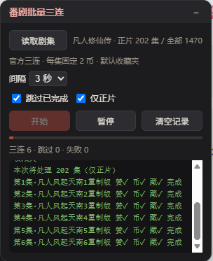
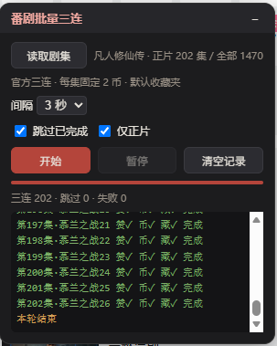

# 番剧批量三连（B 站）

一个 Tampermonkey 用户脚本，用 B 站**官方一键三连接口**，批量给番剧的全部剧集三连（点赞 + 投币 + 收藏）。支持间隔控制、断点续跑、风控保护，并可按「仅正片」过滤掉预告、花絮等附加内容。

## 功能

- 调用官方 `/x/web-interface/archive/like/triple` 接口，一次请求完成三连，比连发三个接口更不易触发风控
- 自动从番剧播放页识别 season，拉取整季剧集列表
- 「仅正片」开关：只处理正片（默认），排除 section 里的预告、花絮、UP 论道等
- 间隔可调（2 / 3 / 5 / 8 秒），连续失败 3 次自动暂停，防止触发风控
- 断点续跑：已完成的剧集记在浏览器 `localStorage`，中断后重跑自动跳过
- 面板实时显示进度与统计，支持拖动、收起

## 重要说明

官方三连接口有三个**固定行为，不可配置**：

| 项 | 行为 |
|---|---|
| 投币数 | 固定 2 枚/集，不能改成 1 枚 |
| 收藏位置 | 默认收藏夹，不能指定 |
| 操作拆分 | 不能拆分，只能三个一起做 |

200 集需要约 400 枚硬币，请确认硬币充足。

## 安装

### 方式一：Tampermonkey（推荐）

1. 给浏览器安装 [Tampermonkey](https://www.tampermonkey.net/) 扩展
2. 点击扩展图标 → 「管理面板」→「新建脚本」
3. 删除编辑器里的所有内容，把本仓库 [`bili-batch-triple.user.js`](bili-batch-triple.user.js) 的全文粘贴进去
4. 按 `Ctrl + S` 保存

### 方式二：浏览器控制台临时运行（无需装插件）

1. 打开番剧任意一集播放页
2. 按 `F12` 打开开发者工具，切到 Console
3. 去掉脚本头部 `// ==UserScript==` 到 `// ==/UserScript==` 之间的注释块
4. 把剩余内容粘贴到控制台，回车执行

> 脚本依赖当前网页的登录态（自动读取 `SESSDATA`、`bili_jct`），**不需要手动提供 Cookie 或 UID**。只要 B 站网页处于登录状态即可。

## 使用

1. 打开番剧播放页，例如 `https://www.bilibili.com/bangumi/play/ss28747`
2. 右下角面板会自动读取剧集并弹出
3. 确认集数（面板顶部显示 `正片 N 集 / 全部 M`）
4. 选好间隔，点「开始」

### 面板效果

运行中（正在逐集三连，日志区实时滚动）：

运行完成（进度条走满，统计显示本轮总数，日志末尾出现「本轮结束」）：

统计栏各项含义：

| 字段 | 含义 |
|---|---|
| 三连 | 赞 / 币 / 藏三项全部成功的集数 |
| 部分成功 | `code=0` 但个别动作之前已做过（如已点过赞）的集数，仍算完成 |
| 跳过 | 因「跳过已完成」而未处理的集数 |
| 失败 | 真正失败的集数，连续 3 次会触发自动暂停 |
| 硬币不足 | 硬币不够的集数 |

### 面板选项

| 选项 | 说明 |
|---|---|
| 间隔 | 2 / 3 / 5 / 8 秒，默认 3 秒 |
| 跳过已完成 | 读浏览器 localStorage，跳过上次成功的集 |
| 仅正片 | 只处理正片（默认勾选），排除 section 里的预告、花絮、UP 论道等；切换时面板集数实时刷新 |
| 读取剧集 | 重新拉取剧集列表 |
| 清空记录 | 清空 localStorage 记录，从头再跑 |

**断点续跑**：完成的剧集记在 `localStorage` 的 `nr_bili_triple_done`，中断后重跑自动跳过。

## 风控与建议

- 短时间几十次请求会触发风控（返回 `-352` / `-412`），脚本内置保护：**连续失败 3 次自动暂停**
- 建议间隔 **3 秒以上**。200 集约 10–15 分钟，属正常节奏
- 触发风控后把间隔调到 5–8 秒，等一会儿再试

## 常见错误码

| 码 | 含义 | 怎么办 |
|---|---|---|
| `0` | 成功 | 再看 `data.like / coin / fav` 三个布尔是否全 true |
| `-101` | 未登录 | 重新登录 B 站 |
| `-111` | csrf 校验失败 | 刷新页面 |
| `-352` | 触发风控 | 间隔调到 5–8 秒，等一会儿再试 |
| `-412` | 请求被拦截 | 同上 |
| `-400` | 请求错误 | 刷新页面重试 |
| `10003` | 稿件不存在 | 该集已下架，正常跳过 |
| `34005` | 投币数超上限 | 今天这个 UP 主投满了 |
| `-104` | 硬币不足 | 面板会记一笔「硬币不足」 |

## 实现要点

- **番剧识别**：从 URL 的 `ss\d+` 或 `window.__INITIAL_STATE__` 的 `pgc.epInfo.season_id` / `mediaInfo.season_id` 取
- **剧集来源**：`GET /pgc/view/web/season?season_id=xxx`。`result.episodes` 是正片；`result.section[]` 是预告、花絮、UP 论道等附加内容。面板数字与实际执行列表都由 `currentList()` 按「仅正片」开关计算，保证显示与行为一致
- **三连**：`POST /x/web-interface/archive/like/triple`（aid + csrf）
- **结果判断**：`code=0` 后仍要检查 `data.like / coin / fav` 三个布尔，部分为 false 表示该项之前已操作过或失败，脚本记为「部分成功」并算作完成

## 风险提醒

这类操作属于自动化脚本，**可能不符合 B 站用户协议**。给自己喜欢的作品三连是个人行为，但请自行判断风险：最坏情况是账号被限制互动功能。脚本已放慢节奏、连续失败自动暂停，但无法保证平台不判定异常。

## 许可

仅供个人学习与研究使用。
